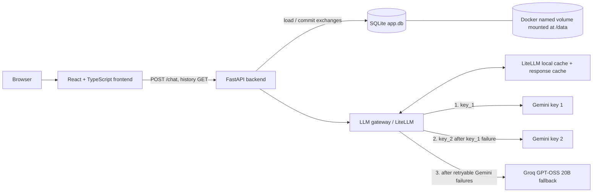

# Resilient AI Chat

A containerized AI chat application featuring multi-provider LLM fallback, persistent conversations, cross-session response caching, and token usage tracking.

## Overview

Resilient AI Chat provides a React interface backed by a FastAPI service. The backend owns conversation history, constructs each request from the current session, and sends it through an ordered LiteLLM gateway. It can use two independent Gemini credentials and, when configured, fall back to Groq GPT-OSS 20B. SQLite stores successful exchanges in a persistent Docker volume.

The application is intended as a single-instance assessment and development project. It does not provide user accounts, authorization, or multi-tenant isolation.

## Key features

- Ordered Gemini credential attempts (`key_1`, then `key_2`) with an optional independent Groq provider fallback.
- LiteLLM for all model requests, including Gemini and Groq.
- Retryable provider failure handling with sanitized server diagnostics.
- Backend-owned multi-turn memory and isolated session identifiers.
- Cross-session response reuse keyed by model identity and the complete model message list.
- SQLite persistence of successful user/assistant exchanges.
- Per-request input and output token metadata, with a documented estimate if provider usage is absent.
- Responsive React chat UI with safe Markdown and response metadata.
- Docker Compose development workflow with a named SQLite volume.

## Architecture



FastAPI validates the request, retrieves prior session messages from SQLite, and adds the current message and optional system prompt. The gateway first checks the deterministic response cache. On a miss, it tries Gemini keys in order, then optionally tries Groq if both Gemini attempts failed with retryable errors. A successful response and its metadata are committed with the user message in one SQLite transaction. Failed requests are not written to history or the response cache.

See [docs/architecture.md](docs/architecture.md) for detailed request, fallback, and persistence diagrams.

## Technology stack

Verified from the repository manifests and Dockerfiles:

| Area | Technology |
| --- | --- |
| Frontend | React 19.3.1, TypeScript 7.0.2, Vite 8.3.8 |
| Markdown | react-markdown 10.1.0, remark-gfm 4.0.1 |
| Frontend tests | Vitest 5.1.2, Testing Library, jsdom 29.1.1 |
| Backend | Python 3.12, FastAPI 0.115.6, Pydantic 2.12.5, pydantic-settings 2.14.1 |
| LLM integration | LiteLLM 1.108.12 |
| Persistence | Python `sqlite3`, SQLite database file |
| Containers | Docker multi-stage builds, Docker Compose |
| Backend tests | pytest 8.3.4, HTTPX 0.28.1 |

The frontend uses `latest` version ranges for some development dependencies. The exact versions used by the current lockfile are listed above; use `npm ci` to install those locked versions.

## Repository structure

```text
backend/
  app/                 FastAPI application, routes, schemas, SQLite and LLM services
  tests/               Deterministic backend contract and provider tests
  Dockerfile           Multi-stage Python image; honors hosting PORT
  requirements.txt     Pinned backend dependencies
frontend/
  src/                 React app, components, API client, tests and styles
  public/favicon.svg   Project favicon
  Dockerfile           Multi-stage Vite build and Nginx runtime
docs/
  architecture.md      System and request-flow diagrams
  api.md               Endpoint schemas and examples
  demo-script.md       Short assessment walkthrough
  github.md            Suggested public repository profile
  screenshots/         Reserved for genuine, reviewed screenshots
docker-compose.yml     Local backend, frontend and persistent named volume
Makefile               up, down, test and frontend-build targets
.env.example           Placeholder configuration only
```

## Prerequisites

- Git
- Docker Desktop with Docker Compose
- Node.js 22 or later only for running the frontend directly or executing its tests outside Docker
- Python 3.12 only for running the backend directly or executing backend tests outside Docker
- Gemini credentials for live Gemini requests
- A Groq API key only if the independent Groq fallback is enabled

## Quick start

The following commands are for Windows Command Prompt. In PowerShell, the copy and editor commands also work as shown.

```cmd
git clone https://github.com/Prince-Singhalia/lyftr-ai-chat-assessment.git
cd lyftr-ai-chat-assessment
copy .env.example .env
notepad .env
docker compose up --build -d
```

Set `LLM_API_KEYS` to two comma-separated Gemini API keys and choose a supported Gemini model in `LLM_MODEL`. To enable cross-provider fallback, set `FALLBACK_LLM_ENABLED=true` and configure `GROQ_API_KEY`. Keep secrets in `.env`; do not commit it.

Open the frontend at <http://localhost:3000>. Check backend health at <http://localhost:8000/health>. Stop the containers with `docker compose down`; this keeps the named volume and its conversation history.

### Run without Docker

Backend, from PowerShell:

```powershell
py -3.12 -m venv .venv
.\.venv\Scripts\Activate.ps1
python -m pip install -r backend\requirements.txt
Set-Location backend
uvicorn app.main:app --reload
```

Frontend, in a second terminal from the repository root:

```powershell
Set-Location frontend
npm ci
npm run dev
```

The non-Docker SQLite location follows `DATABASE_URL`. If unset, the application default points to `/data/app.db`; set a local writable SQLite URL such as `sqlite:///./data/app.db` for development outside containers.

## Environment configuration

The application reads environment variables through Pydantic Settings. `.env.example` contains placeholders and safe development defaults; production values belong in the hosting provider’s environment settings.

| Variable | Required | Purpose |
| --- | --- | --- |
| `LLM_API_KEYS` | Yes for live Gemini use | Ordered comma-separated Gemini API keys. Whitespace around entries is trimmed. The API receives one key per call. |
| `LLM_MODEL` | Yes for live Gemini use | LiteLLM Gemini model identifier, for example `gemini/gemini-3.1-flash-lite`. |
| `GROQ_API_KEY` | Optional | Groq credential. Used only when fallback is enabled and both Gemini calls fail retryably. |
| `FALLBACK_LLM_ENABLED` | Optional; defaults to `false` | Enables third-level Groq fallback. |
| `FALLBACK_LLM_MODEL` | Optional | Groq model identifier; default is `groq/openai/gpt-oss-20b`. |
| `DATABASE_URL` | Optional; defaults to `sqlite:////data/app.db` | SQLite connection URL. In Docker, use the named volume path `/data/app.db`. |
| `ALLOWED_ORIGINS` | Optional | Comma-separated browser origins allowed by CORS. Set the exact production frontend origin. |
| `VITE_API_BASE_URL` | Optional in local Compose; required for separate production frontend hosting | Backend base URL baked into the Vite build. Do not use a local URL for a public build. |
| `LITELLM_CACHE` | Optional; defaults to `true` | Enables the LiteLLM local cache and the application response cache. |
| `ENABLE_FAILURE_SIMULATION` | Optional; defaults to `false` | Enables `X-Simulate-Failure` for demonstrations/tests. Keep disabled in production. |
| `LLM_API_BASE` | Optional | Custom provider API base when required by the configured LiteLLM provider. |
| `CACHE_DIR` | Optional | Cache directory setting; the current response cache is in process memory. |
| `ENVIRONMENT` | Optional | Deployment environment label. |
| `LOG_LEVEL` | Optional | Backend logging level. |

Health requires reachable SQLite, at least two Gemini keys, and cache initialization. Groq is optional and does not replace the two-key Gemini requirement.

## API documentation

The API consists of three routes; OpenAPI, Swagger UI, and ReDoc are disabled. See [docs/api.md](docs/api.md) for the full contract.

### `GET /health`

Healthy response (`200`):

```json
{"status":"ok","keys_configured":2,"cache_enabled":true}
```

Returns `503` with `{"detail":"service unavailable"}` if SQLite, the two-key requirement, or cache initialization is unhealthy.

### `POST /chat`

Request:

```json
{"session_id":"demo-1","message":"What is a database index?"}
```

Optional `system_prompt` may be included. On success the response contains `session_id`, `reply`, and `metadata` with `resolution_source`, actual `model`, server `latency_ms`, per-request `input_tokens` and `output_tokens`, `key_id`, and `fallback_attempts`.

### `GET /sessions/{session_id}/messages`

Returns successful user and assistant messages oldest first. System prompts are not stored or returned. An unknown or empty session returns `404` and `{"detail":"session not found"}`.

Invalid payloads return `422` with a JSON validation detail. If all providers are unavailable, `POST /chat` returns `503` and `{"detail":"all providers unavailable"}`. Provider exceptions are not returned to clients.

## Caching

The application response cache uses a deterministic key from the configured primary model identity and the complete ordered model message list. That list contains any system prompt, prior turns, and the current message. Session ID and provider credentials are not part of the key, which permits reuse across sessions without sharing responses across different prompts or histories. Cached entries retain the response text, actual responding model, and original token counts; cache metadata reports `LLM_CACHE`, null `key_id`, and zero fallback attempts.

The response cache is process-local, so it is lost on backend restart and is not shared across multiple workers or replicas. Recognized failure simulation requests bypass it. Failed provider attempts are never added to the response cache.

## Conversation persistence

SQLite creates the `messages` table automatically. It stores an integer ID, session ID, role, content, optional assistant metadata as JSON, and an ISO-8601 timestamp. Each successful exchange inserts the user and assistant messages transactionally. Failed calls are not persisted.

Compose mounts the named volume `app_data` at `/data`, with `DATABASE_URL=sqlite:////data/app.db`. `docker compose down` preserves this named volume; `docker compose down -v` deletes it and must not be used for routine development. SQLite is appropriate for this single-instance project; it is not a shared database for horizontally scaled application replicas.

## Provider fallback

The gateway tries Gemini `key_1`, then Gemini `key_2`. Groq GPT-OSS 20B is attempted only when both Gemini attempts have retryable failures and Groq is enabled and configured. Retryable categories include HTTP 408, 429, 500, 502, 503, and 504, plus network errors and timeouts. Authentication or invalid-model failures are not treated as retryable for the cross-provider step.

`fallback_attempts` counts failed deployments before the response: normally 0 or 1 for Gemini success and 2 for Groq success. `metadata.model` reports the provider model that actually generated the answer. The backend test suite uses deterministic mocked providers; live Gemini and Groq checks are separate and can be affected by provider quotas and outages. A successful mocked test is not evidence of live provider availability.

## Failure simulation

Set `ENABLE_FAILURE_SIMULATION=true` only in a controlled development environment. The header affects the current request and only supports these status values: `429`, `500`, `502`, `503`.

Supported tokens are `key_1=STATUS`, `key_2=STATUS`, `groq=STATUS`, `fallback=STATUS` (Groq alias), and `*=STATUS` (all deployments). Tokens may be comma-separated. Examples for Windows Command Prompt:

```cmd
curl -X POST http://localhost:8000/chat -H "Content-Type: application/json" -H "X-Simulate-Failure: key_1=429" -d "{\"session_id\":\"demo-key2\",\"message\":\"Hello\"}"
curl -X POST http://localhost:8000/chat -H "Content-Type: application/json" -H "X-Simulate-Failure: key_1=503,key_2=503" -d "{\"session_id\":\"demo-groq\",\"message\":\"Hello\"}"
curl -X POST http://localhost:8000/chat -H "Content-Type: application/json" -H "X-Simulate-Failure: key_1=503,key_2=503,groq=503" -d "{\"session_id\":\"demo-all-fail\",\"message\":\"Hello\"}"
```

A provider that is not simulated must make a real LiteLLM request. Simulation does not fabricate a successful assistant reply. Requests with recognized simulation values bypass the response cache.

## Testing

From the repository root:

```powershell
python -m pytest backend/tests -v
Set-Location frontend
npm ci
npm test
npm run build
Set-Location ..
docker compose config --quiet
docker compose run --rm backend pytest -v
```

Backend tests mock provider calls and do not require live API keys. The frontend suite uses Vitest and Testing Library. Live provider diagnostics are manual and should be reported separately from unit-test results.

## Docker operations

```powershell
docker compose up --build -d
docker compose ps
docker compose logs --tail=100
docker compose restart backend
docker compose run --rm backend pytest -v
docker compose down
```

`docker compose down` stops and removes containers/network but retains the named `app_data` volume. Avoid `docker compose down -v` unless permanently deleting local history is intentional. The Makefile also supplies `make up`, `make down`, `make test`, and `make frontend-build`; on Windows without GNU Make, use the Compose and npm commands above.

## Deployment

No public deployment URL is currently verified. For Render, create a Docker Web Service using Dockerfile `backend/Dockerfile`, build context `backend`, health path `/health`, and a persistent disk mounted at `/data`. Set provider secrets in Render’s environment panel and set `DATABASE_URL=sqlite:////data/app.db`, `PORT` (Render supplies it), and the exact frontend origin in `ALLOWED_ORIGINS`.

For Vercel, import the repository with root directory `frontend`, build command `npm run build`, and output directory `dist`. Configure `VITE_API_BASE_URL` with the deployed backend HTTPS URL, then update backend CORS to the exact Vercel origin. Do not publish a deployment URL until external health and frontend-to-backend requests have been verified.

## Security

- Store credentials in environment variables or the hosting provider’s secret manager. `.env` and `.env.*` are ignored; `.env.example` contains placeholders only.
- The frontend receives only the backend URL, never provider keys.
- Provider failures are sanitized in server logs and clients receive generic errors.
- Pydantic validates session IDs and message lengths; system prompts are omitted from history.
- CORS should allow only the intended frontend origin. CORS is not authentication.
- Assistant Markdown uses `react-markdown` and `remark-gfm` without `dangerouslySetInnerHTML`; raw HTML is not enabled.
- Set `ENABLE_FAILURE_SIMULATION=false` in production.
- The API has no authentication or rate limiting. Do not expose it to untrusted public traffic without adding appropriate access controls and abuse protections.
- Use persistent storage for SQLite and keep this deployment to one backend instance unless storage and cache coordination are redesigned.

## Limitations

Provider quotas, rate limits, model availability, network conditions, and free-tier restrictions may interrupt inference. Gemini fallback keys may share provider-side capacity or quota limits. Groq is optional and only handles retryable Gemini failures. The response cache is process-local and is cleared by restarts. SQLite and the in-memory cache do not coordinate across replicas. If a provider omits token usage, the application estimates counts from whitespace-separated text rather than claiming exact tokenizer usage.

## Roadmap

Planned possibilities, not implemented features:

- Add authentication and request-level rate limits before broad public exposure.
- Add browser-level end-to-end tests for deployed-origin behavior.
- Evaluate a multi-instance persistence/cache design if horizontal scaling becomes necessary.

## License

This project is licensed under the MIT License. See [LICENSE](LICENSE).

## Maintainer

See the repository owner listed on GitHub for project maintenance and contact information. No separate support email is published here.

## Acknowledgements

This project uses React, Vite, FastAPI, Pydantic, LiteLLM, SQLite, `react-markdown`, `remark-gfm`, Docker, and the Gemini and Groq model APIs. See the respective package manifests for dependency details.
