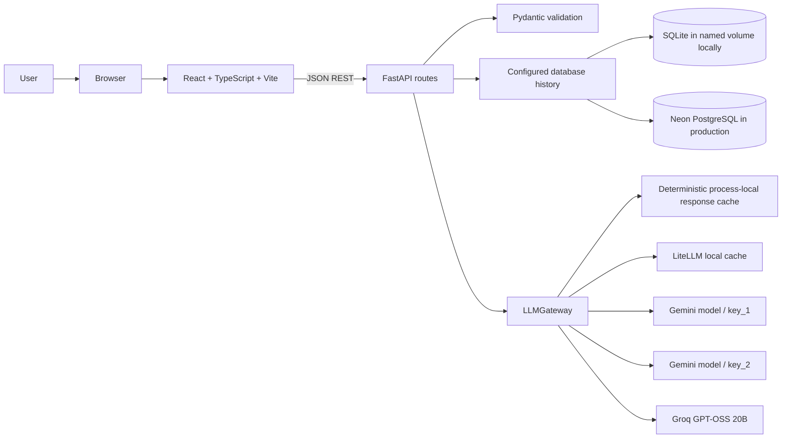
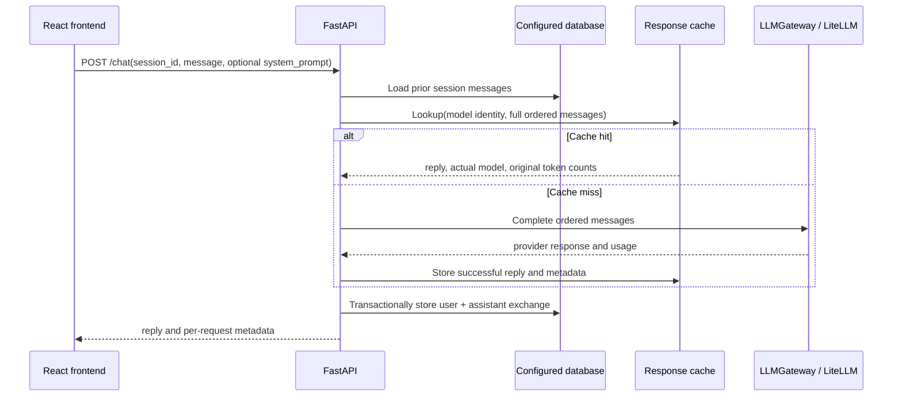
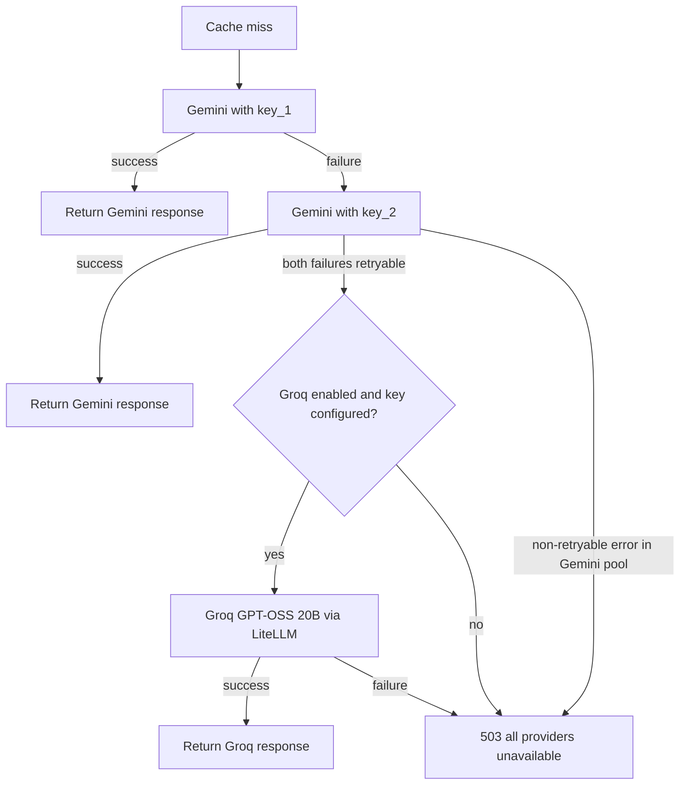

# Architecture

## High-level system



## Chat request lifecycle



## Provider fallback



## Request and provider details

The browser creates a fresh UUID session ID when the page loads and sends only that ID, the new message, and an optional system prompt. The backend reads previous user/assistant rows oldest first and constructs the ordered message list. It does not store system prompts in the messages table.

The gateway splits and trims `LLM_API_KEYS`; each element is sent individually to LiteLLM. `key_1` and `key_2` are stable metadata identifiers, never key values. Groq is attempted only when both Gemini deployments fail retryably, `FALLBACK_LLM_ENABLED=true`, and `GROQ_API_KEY` is present. Retryable HTTP statuses are 408, 429, 500, 502, 503, and 504; network failures and timeouts are also retryable. Other provider errors produce the generic 503 response after Gemini attempts.

`fallback_attempts` counts failed deployments before success. `model` is the model that produced the reply, including on cache hits. Provider usage fields are used when supplied; otherwise the implementation estimates from whitespace-separated text.

## Cache key and behavior

The application response cache hashes JSON containing the configured primary model identity and the full ordered message list. Session ID, API key, and request ID do not affect identity. This supports identical first prompts across sessions while isolating different prompts, system prompts, histories, or model settings. A stored result retains reply, actual model, and token counts. Recognized failure simulation headers bypass this response cache; unsuccessful calls never populate it.

LiteLLM's local cache is also initialized for completion calls when enabled. The application cache that assigns `LLM_CACHE` labels is an in-memory `CacheService`. Both caches are process-local; they are not durable or coordinated across replicas.

## Persistence model

The selected database creates this logical table on app initialization. SQLite uses `INTEGER PRIMARY KEY AUTOINCREMENT`; PostgreSQL uses `BIGSERIAL`. Both use text metadata and timestamps, retaining the existing response/history contract.

```sql
CREATE TABLE messages (
    id INTEGER PRIMARY KEY AUTOINCREMENT,
    session_id TEXT NOT NULL,
    role TEXT NOT NULL,
    content TEXT NOT NULL,
    metadata TEXT,
    created_at TEXT NOT NULL
);
```

An index orders messages by session and ID. A version row in `schema_migrations` records the idempotent initial schema setup. Successful exchanges insert a user row and an assistant row with JSON metadata in one transaction. Failed inference is not stored. SQLite is used locally and by Docker Compose, which mounts `app_data` at `/data` and uses `sqlite:////data/app.db`. Production uses PostgreSQL selected by `DATABASE_URL`; PostgreSQL connection failures fail startup and do not fall back to in-memory or SQLite storage. SSL downgrade modes are rejected.

The response cache remains a process-local `CacheService`; it is not stored in either database. Successful exchanges keep actual model metadata and token usage in `messages.metadata`, so those survive PostgreSQL restarts independently of cache entries. `app.migrate_sqlite` can copy an existing file-backed SQLite history into an empty PostgreSQL `messages` table without modifying the source file.

## Errors and security boundaries

FastAPI returns 422 for invalid request bodies, 404 for unknown/empty message history, and `503 {"detail":"all providers unavailable"}` after exhausted provider attempts. Raw provider exceptions do not reach clients. Logs include safe key IDs, provider categories, statuses, and sanitized messages. `X-Simulate-Failure` is ignored unless `ENABLE_FAILURE_SIMULATION=true`.

CORS is configured from `ALLOWED_ORIGINS`, but CORS does not authenticate API clients. The current service does not implement user authentication, authorization, or rate limiting.

## Docker and deployment topology

Locally, Compose runs the backend on port 8000 and the Nginx-served frontend on port 3000. The backend listens on `0.0.0.0` and uses the `PORT` environment variable, defaulting to 8000. The backend is a non-root user. The frontend gets its backend URL through `VITE_API_BASE_URL` at build time.

For production, the documented topology is one Render Docker Web Service using Neon PostgreSQL, plus a Vercel static frontend. Configure the Vercel URL as the backend's exact allowed CORS origin. No production deployment URL is currently verified. The process-local cache is not shared across replicas.
